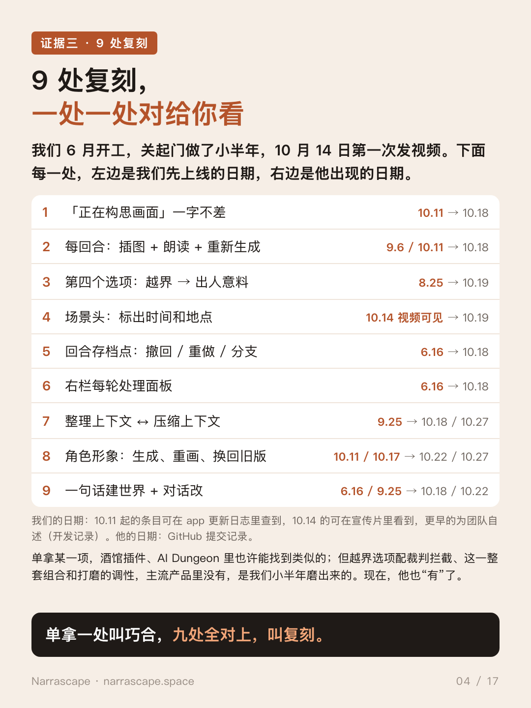

**English** | [简体中文](README.zh-CN.md)

# Copied, then called original: CicaTavern vs. Narrascape

> **Try Narrascape: [narrascape.space](https://narrascape.space)**, no install, runs in the browser.

[Narrascape](https://narrascape.space) is an AI tabletop / interactive-fiction web app. We spent years on the idea, built it behind closed doors from June 2026, and published our **first promo video on October 14, 2026**.

Six days later (around October 20), a project called **CicaTavern** started promoting itself on Xiaohongshu. Its headline features line up, one after another, with the ones we had already shipped and shown.

**We believe CicaTavern replicated Narrascape's features, selling points and UI copy.** We are not claiming the code was copied: the tech stack is different. What was taken is the product: what to build, how it behaves, and what the screens say.

Everything below links to public material. His repository has been forked as an archive at **[advnljs/CicaTavern](https://github.com/advnljs/CicaTavern)** (frozen at `14a14e9`, v2.0.2, 48 commits), so the evidence stays even if the original changes.

## 1. The timeline does not add up

| When (UTC+8) | Narrascape | CicaTavern |
|---|---|---|
| Jun 15 | Day one: turn choices, a "space-time judge" that can reject impossible actions, and a restriction setting | — |
| Jun 16 | Frozen baseline (append-only context for cache hits); world generator | — |
| Aug 25 | The fourth "transgression" choice is finalized | — |
| Sep 6 | Read-aloud (added for livestreaming) | — |
| Oct 11–17 | Turn illustrations, character portraits, consistent art style, background jobs, portrait history | — |
| **Oct 14** | **First public promo video** | — |
| Oct 18 01:30 | | GitHub repo created; v1.0.0 lands as **one 17,472-line commit**; 20 commits and 6 versions that day |
| Oct 19 | | v1.6.0 adds four built-in action choices, "at least one surprising" |
| ~Oct 20 | | Promo note posted on Xiaohongshu |
| Oct 27 | | v2.0.0 "draw history"; v2.0.3 context meter with auto-compaction |

No earlier development trace for CicaTavern exists in any of the author's public repositories. Features appear fully finished in the first commit (2,489 lines of image and voice code, plus 551 lines of tests), with no iteration and no stated reason. His issue tracker has 3 issues, none asking for any of these features.

## 2. Nine replication points

| # | Point | Narrascape | CicaTavern |
|---|---|---|---|
| 1 | Image placeholder text **「正在构思画面」, identical** | Oct 11 | Oct 18 ([`web/media.js` L164](https://github.com/Shikasar7/CicaTavern/blob/cac0f965d3b68583f2ee73c536702a9d0823a7a9/web/media.js#L164)) |
| 2 | Under each turn: illustration + read aloud + regenerate | Sep 6 / Oct 11 | Oct 18 |
| 3 | Fourth choice: our "transgression" → his "surprising" | Aug 25 | Oct 19 ([`server/basic.mjs` L101–108](https://github.com/Shikasar7/CicaTavern/blob/48fa11bdfb9af6bda3614921208eb5c01524a705/server/basic.mjs#L101-L108)) |
| 4 | Scene header with time and place | visible in the Oct 14 video | Oct 19 |
| 5 | Per-turn checkpoints: undo / redo / branch | Jun 16–17 | Oct 18 |
| 6 | Right-side panel with each turn's processing data | Jun 16 | Oct 18 |
| 7 | "Consolidate context" ↔ "compress context", auto when over the limit | Sep 25 / Oct 16 | Oct 18 / Oct 27 ([`d7974cb`](https://github.com/Shikasar7/CicaTavern/commit/d7974cb)) |
| 8 | Character portraits: generate, redraw, switch back to an older version | Oct 11 / Oct 17 | Oct 22 / Oct 27 ([`d276733`](https://github.com/Shikasar7/CicaTavern/commit/d276733)) |
| 9 | Build a world from a few lines, then edit it by chat ("基调", "想怎么改") | Jun 16 / Sep 25 | Oct 18 / Oct 22 |

Each point has a side-by-side card in [`comparison/`](comparison/).

Any single item might exist somewhere else, in a SillyTavern extension or in AI Dungeon. **This combination does not exist in mainstream products, and neither does the way it is tuned.** One example is a fourth choice built to run into a judge, followed by a prompt that sends players to settings to loosen the restriction. That took us months. It appeared in CicaTavern within days of our video.

## 3. The transgression choice: copied without the mechanism

In Narrascape, the fourth choice each turn is deliberately out of bounds: the thing you most want to do but would not dare. Our space-time judge may block it. The rejection dialog then says the restriction can be adjusted or turned off in Game Settings. The choice exists to make players hit that judge and discover how far the world will go with them.

CicaTavern added "four action options, at least one surprising" on October 19, five days after our video. It has no judge and no restriction setting, so the fourth option has nothing to run into and nothing to unlock. The behaviour was copied without the mechanism that gives it a reason to exist.

| Narrascape (Oct 14 video) | CicaTavern (his video, ~00:38) |
|---|---|
|  |  |

## 4. The 97% headline

The largest number in his promo video is "cache hit rate up to 97%". His own README ([L37–45](https://github.com/Shikasar7/CicaTavern/blob/14a14e9687ff58c7fd9cc13213858d859013dc0a/README.md?plain=1#L37-L45)) says the Claude rows come from the author's personal setup running through Claude Code. Another part of the same README says a Claude subscription cannot be used as an API key. The DeepSeek row covers 13 turns.

## What we ask

1. The first version was a finished 17,472-line commit. Where is the development history from before October 18?
2. Why does a product with no judge add a "surprising" fourth choice on October 19, and does it have anything to do with our October 14 video?
3. Did you play narrascape.space or watch our video before building all of this?

If it was inspired by Narrascape, say so in the README. Taking inspiration is not shameful; pretending not to know us is.

## Contents

| Folder | What is inside |
|---|---|
| [`statement/`](statement/) | Full statement in Chinese (`statement-zh.pdf`, source `index.html`) with a screenshot appendix |
| [`list/`](list/) | 29 graded suspicious points in Chinese (`suspicious-points-zh.pdf`) |
| [`comparison/`](comparison/) | Overview card + 9 side-by-side cards (features and UI copy) |
| [`xiaohongshu/`](xiaohongshu/) | The 17-image Xiaohongshu post and its caption |
| [`evidence/their-repo/`](evidence/their-repo/) | Screenshots of his GitHub pages taken Oct 27, 2026; the v2.0.3 changelog text |
| [`evidence/their-video/`](evidence/their-video/) | Frames and a transcript of his promo video |
| [`evidence/their-xiaohongshu/`](evidence/their-xiaohongshu/) | His Xiaohongshu note ("7 days ago" on Oct 27) |
| [`evidence/our-video/`](evidence/our-video/), [`evidence/our-live/`](evidence/our-live/) | Frames from our Oct 13 livestream (used in the Oct 14 video) and our live client |

## Notes on sources

- **CicaTavern dates** come from its public commit history and changelog. GitHub groups commits by UTC, so "Oct 17" in screenshots is October 18 in UTC+8.
- **Narrascape dates from Oct 11 onward** are visible in the in-app changelog (✦ in the top bar of narrascape.space). That changelog launched on Oct 19, and earlier days were filled in at launch.
- **Narrascape dates before Oct 11** come from our own development history. The Oct 14 promo video is the public timestamp for what it shows.
- Screenshots of his repository and videos are included for commentary and comparison.

— Narrascape · [narrascape.space](https://narrascape.space)
