[English](README.md) | **简体中文**

# 更正与致歉（2026 年 10 月 29 日）

**现行结论：按照现有证据，不足以证明 CicaTavern 抄袭 Narrascape。** 我撤回此前在本仓库作出的确定性抄袭、复刻指控，并为过早下结论道歉。感谢作者的回应和补充资料。现有材料也不能证明作者从未参考 Narrascape 或开发完全独立；对此不作断言。

重新核查后的主要限制：公开仓库的首个完整版提交不等于私下开发的起点；作者展示了私有仓库的 Git 截图，但其完整提交对象和历史日期尚未独立核验；SillyTavern 社区已有行动选项、时间框、配图和朗读等先例，相同短语或功能出现顺序不能单独证明来源。原清单第 7 项把“至少一项出人意料”误读为固定第四项；第 13 项把文字回合关页续写与图片任务关页继续相比；第 15 项把供绘图的角色名册等同于叙事动态记忆。这些比较需要更正，相关功能也不能作为彼此独立的巧合概率相乘。

更正依据包括[作者回应](https://github.com/Shikasar7/CicaTavern/issues/4#issuecomment-6477278101)、[四选项规则](https://github.com/Shikasar7/CicaTavern/blob/48fa11bdfb9af6bda3614921208eb5c01524a705/server/basic.mjs#L100-L111)，以及首个公开版本的[文字回合](https://github.com/Shikasar7/CicaTavern/blob/cac0f965d3b68583f2ee73c536702a9d0823a7a9/server/http.mjs#L168-L178)、[图片请求](https://github.com/Shikasar7/CicaTavern/blob/cac0f965d3b68583f2ee73c536702a9d0823a7a9/server/http.mjs#L680-L714)和[叙事提示词](https://github.com/Shikasar7/CicaTavern/blob/cac0f965d3b68583f2ee73c536702a9d0823a7a9/server/prompt.mjs#L63-L105)代码路径。

以下是 10 月 27 日发表的原始材料，保留供核查。**其中的指控与结论已经撤回，不应作为现行立场引用。** 历史 PDF 和图片不改动，可能仍包含已撤回的说法。

展开已撤回的历史声明与图片

[English](README.md) | **简体中文**

# 抄就抄了，别装原创：CicaTavern 与 Narrascape

> **Narrascape 产品地址：[narrascape.space](https://narrascape.space)**，网页打开就能玩，不用安装。

## 一句话说清

- **我们从 2023 年就在公开探索**（[scripted-rpg](https://github.com/advnljs/scripted-rpg)），2026 年 6 月起关起门做 [Narrascape](https://narrascape.space)，**10 月 14 日第一次发宣传片**。
- **4 天后**，CicaTavern 的仓库出现在 GitHub，第一版就是**一次提交 17,472 行**；**6 天后**，他的宣传笔记上了小红书。
- 我们整理了 **9 处功能与界面文案的复刻**，其中有**一字不差的界面文案**，还有一个被抄走、却没有背后机制的“越界”第四选项。
- 重合的功能，**每一项都是我们先上线**，领先 **5 天到 4 个月**；他的全挤在**我们宣传片之后的 4 到 13 天**里。
- **我们不说他抄代码**，技术栈不一样。他拿走的是产品：做什么、怎么表现、界面上写什么。

他的仓库已 fork 存档：**[advnljs/CicaTavern](https://github.com/advnljs/CicaTavern)**（停在 `14a14e9`，2.0.2，48 个提交），文中引用的每个提交都能查。

## 证据文档

| 文档 | 中文 | English |
|---|---|---|
| 完整声明（含截图附录） | [PDF](statement/statement-zh.pdf) | [Markdown](statement/statement-en.md) · [PDF](statement/statement-en.pdf) |
| 29 项分级可疑点清单 | [PDF](list/suspicious-points-zh.pdf) | [Markdown](list/suspicious-points-en.md) |
| 9 张左右对照图 | [`comparison/`](comparison/) | [`comparison/en/`](comparison/en/) |
| 完整图集（17 张） | [`xiaohongshu/`](xiaohongshu/) | [`evidence-en/`](evidence-en/) |

## 我们 2023 年就开始了，公开可查

[**scripted-rpg**](https://github.com/advnljs/scripted-rpg) 是我们 **2023 年 6 月**的公开仓库，2023 年 6 月到 11 月共 20 个提交。它把一段固定剧情（洛夫克拉夫特的《墙中鼠》）变成由大模型主持的文字 RPG，当时就已经有：

- 带**隐藏真相**的剧本，玩家一步步揭开；
- **关键剧情节点**，不管玩家怎么选，故事都会被拉回主线；
- **玩家控制不了的世界事件**：“玩家只控制自己角色的选择，控制不了整个故事世界的变化”；
- 负责记忆的**知识 agent**；
- 给场景配 **Stable Diffusion 插图**。

Narrascape 就是这条路往下走的结果，示例世界也还是洛夫克拉夫特：《疯狂山脉》。

## 时间线

| 时间（北京时间） | Narrascape | CicaTavern |
|---|---|---|
| 2023 年 6 月 | 公开仓库 [scripted-rpg](https://github.com/advnljs/scripted-rpg)：文字 RPG + AI 配图 | — |
| 2026 年 6 月 15 日 | 项目第一天：每回合选项、能拦下不合理行动的时空裁判、行为限制设置 | — |
| 6 月 16 日 | 冻结基线（只往后追加，每轮命中缓存）；世界生成器；回合存档点 | — |
| 7 月 14 日 | 网站上线，没做宣传 | — |
| 8 月 25 日 | 第四个“越界”选项定型 | — |
| 9 月 6 日 | 朗读，为直播加的 | — |
| 9 月 25 日 | 上下文超出窗口才整理；用对话改新世界 | — |
| 10 月 11—17 日 | 回合插图、角色形象、统一画风、后台任务、历史形象 | — |
| **10 月 14 日** | **第一次公开发宣传片** | — |
| 10 月 18 日 01:30 | | 仓库创建；1.0.0 **一次提交 17,472 行**；当天 20 个提交、6 个版本 |
| 10 月 19 日 | | 1.6.0：内置四个行动选项，“至少一项出人意料”；“时间框” |
| 10 月 20 日前后 | | 小红书宣传笔记 |
| 10 月 22 日 | | 生成头像；对话修改角色卡 |
| 10 月 27 日 | | 2.0.0 抽图历史；2.0.3 上下文用量表 + 自动压缩 |

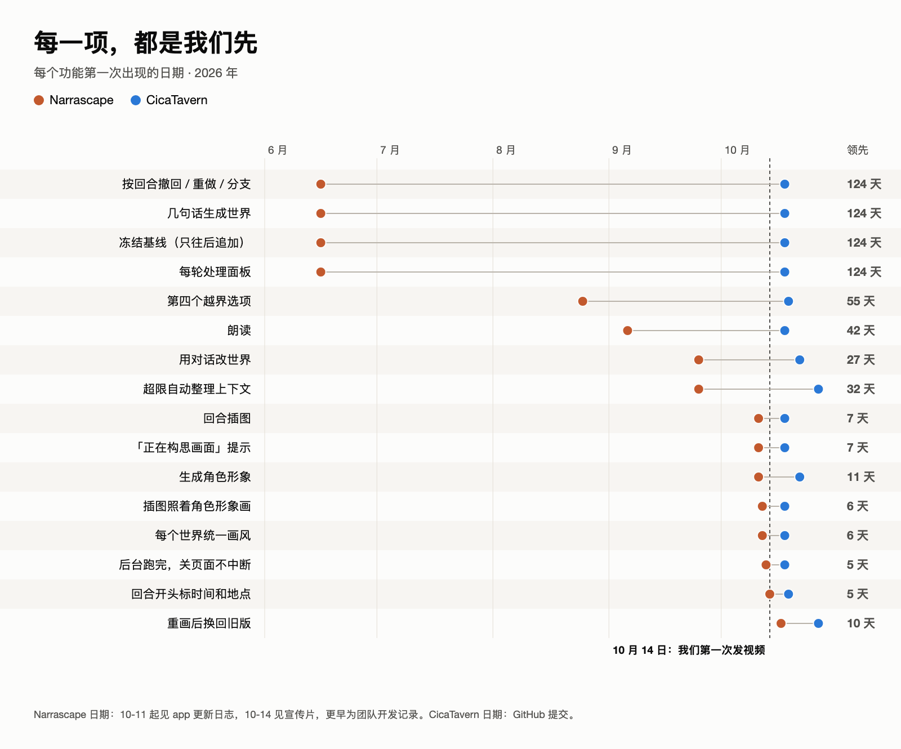

## 证据，一张一张看

下面 17 张图就是全部证据，也是我们发在小红书上的那一组。

### 一、小半年 vs. 一个星期

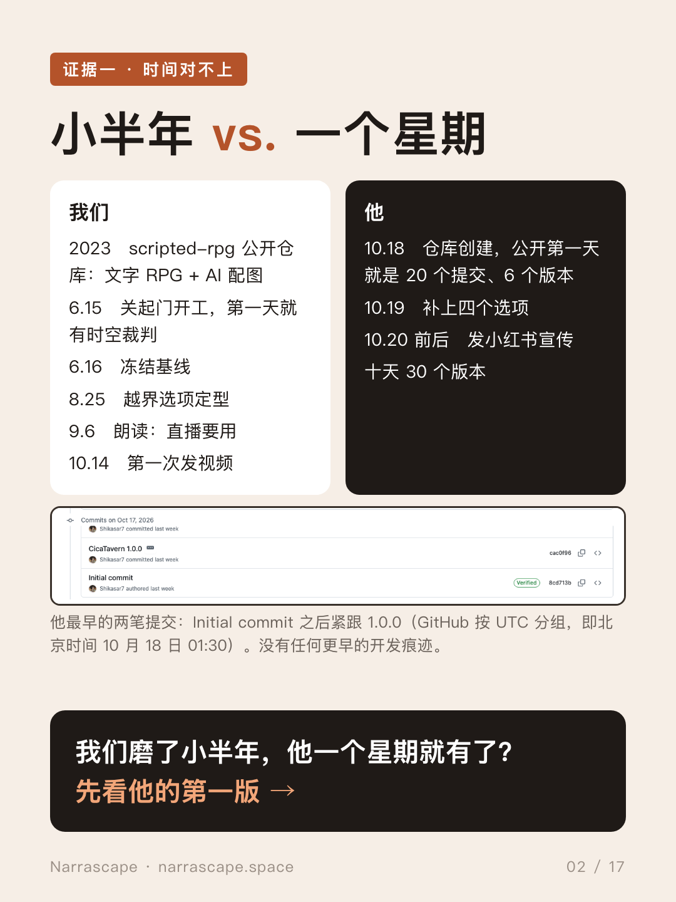

从 2023 年的 scripted-rpg 到 2026 年 6 月开工，这一套我们做了几个月。他的公开记录只有十天：30 个版本、7 万多行；光 10 月 18 日就是 20 个提交、6 个版本，安卓 App、exe 启动器、应用内更新同一天出来。他所有公开仓库里，找不到任何更早的 CicaTavern 开发痕迹。

### 二、他的第一版，一出现就是成品

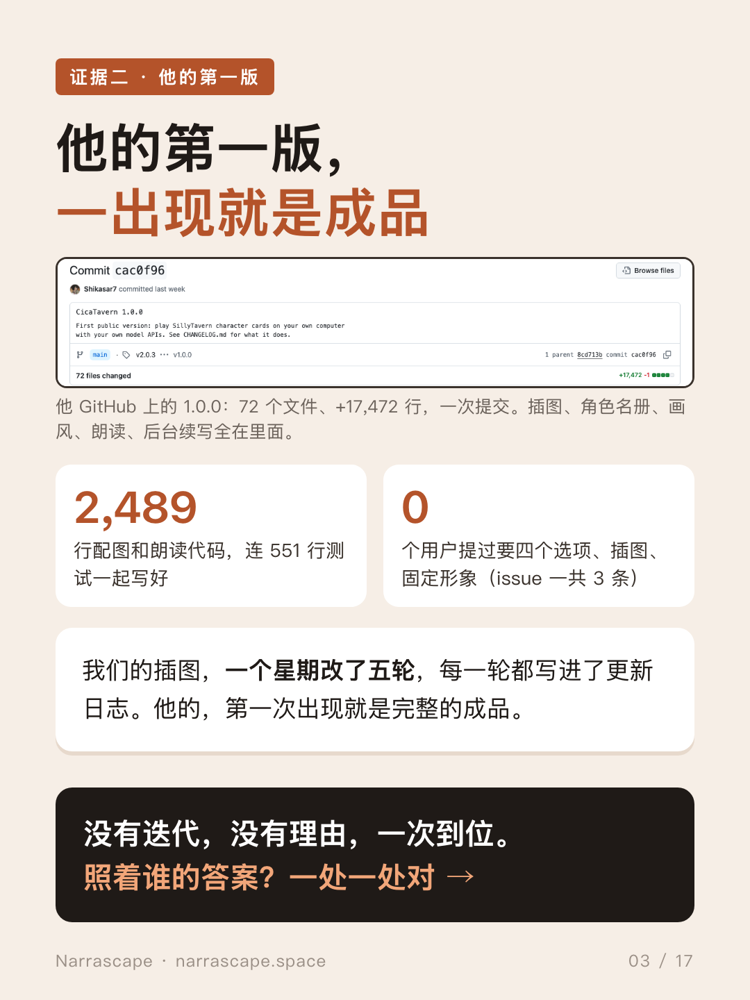

插图、角色名册、画风、朗读、后台续写，全在 [1.0.0 那一次提交](https://github.com/Shikasar7/CicaTavern/commit/cac0f96)里：配图和朗读代码 2,489 行，连 551 行测试一起写好。没有“先做个简单的”，没有迭代。issue 一共 3 条，没有人提过这些需求。

### 三、9 处复刻

| # | 复刻点 | Narrascape | CicaTavern |
|---|---|---|---|
| 1 | 出图提示 **「正在构思画面」一字不差** | 10-11 | 10-18（[`web/media.js` 第 164 行](https://github.com/Shikasar7/CicaTavern/blob/cac0f965d3b68583f2ee73c536702a9d0823a7a9/web/media.js#L164)） |
| 2 | 每回合下面：插图 + 朗读 + 重新生成 | 9-6 / 10-11 | 10-18 |
| 3 | 第四个选项：我们的“越界”→ 他的“出人意料” | 8-25 | 10-19（[`server/basic.mjs` 第 101–108 行](https://github.com/Shikasar7/CicaTavern/blob/48fa11bdfb9af6bda3614921208eb5c01524a705/server/basic.mjs#L101-L108)） |
| 4 | 回合开头先标时间和地点 | 10-14 宣传片可见 | 10-19 |
| 5 | 按回合撤回 / 重做 / 分支 | 6-16—6-17 | 10-18 |
| 6 | 右栏放每轮处理数据 | 6-16 | 10-18 |
| 7 | 整理上下文 ↔ 压缩上下文，超限自动 | 9-25 / 10-16 | 10-18 / 10-27（[`d7974cb`](https://github.com/Shikasar7/CicaTavern/commit/d7974cb)） |
| 8 | 角色形象：生成、重画、换回旧版 | 10-11 / 10-17 | 10-22 / 10-27（[`d276733`](https://github.com/Shikasar7/CicaTavern/commit/d276733)） |
| 9 | 几句话建世界，再用对话改（“基调”“想怎么改”） | 6-16 / 9-25 | 10-18 / 10-22 |

#### 复刻 1：「正在构思画面」一字不差

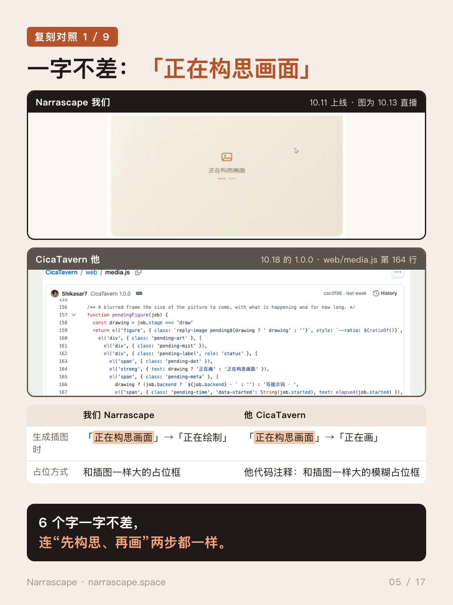

生成插图时，两边都先显示同样的六个字「正在构思画面」，再进入“画”的阶段。我们 10 月 11 日上线，他的在 10 月 18 日的第一笔提交里。

#### 复刻 2：每回合下面，插图 + 朗读 + 重新生成

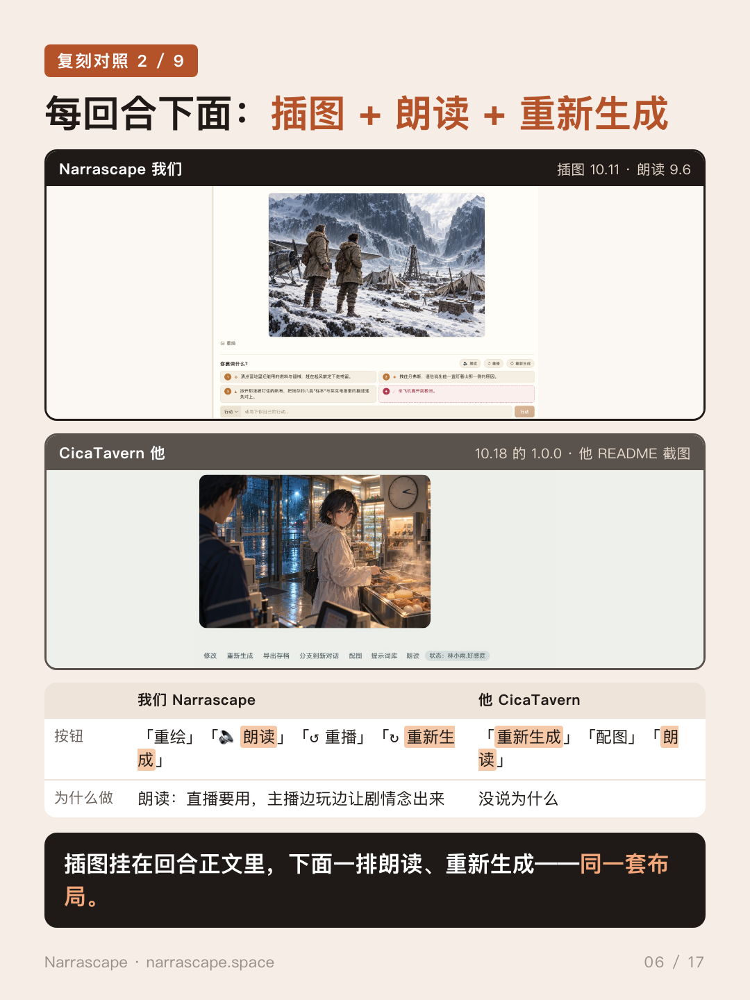

插图挂在回合正文里，下面一排朗读、重新生成。我们的朗读是 9 月 6 日为直播加的；他的没说为什么。

#### 复刻 3：第四个选项

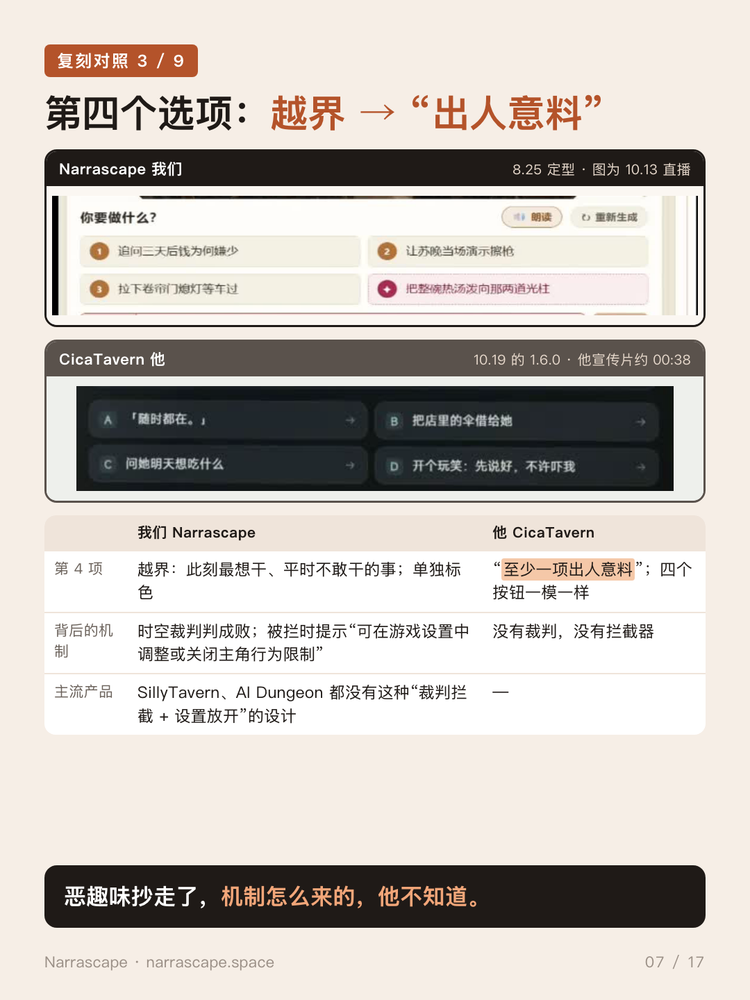

我们的第四个选项是你此刻最想干、平时不敢干的事，会撞上时空裁判，被拦下时引导你去游戏设置里放开限制。他的第四个选项是“至少一项出人意料”，背后没有裁判，也没有行为限制设置。

#### 复刻 4：回合开头先标时间和地点

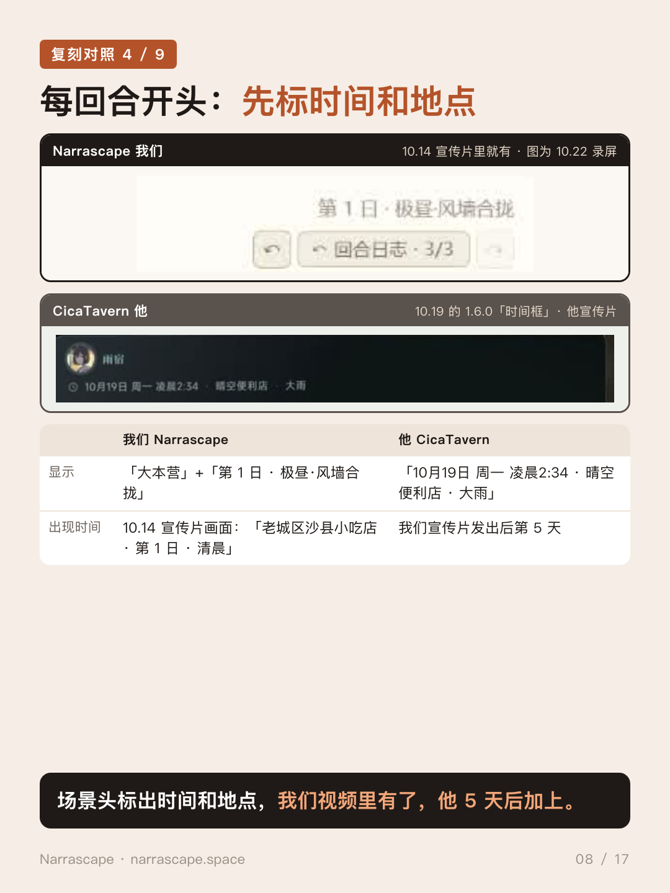

我们的场景头（地点 + 第几日）10 月 14 日的宣传片里就有；他的“时间框”10 月 19 日才加。

#### 复刻 5：按回合存档

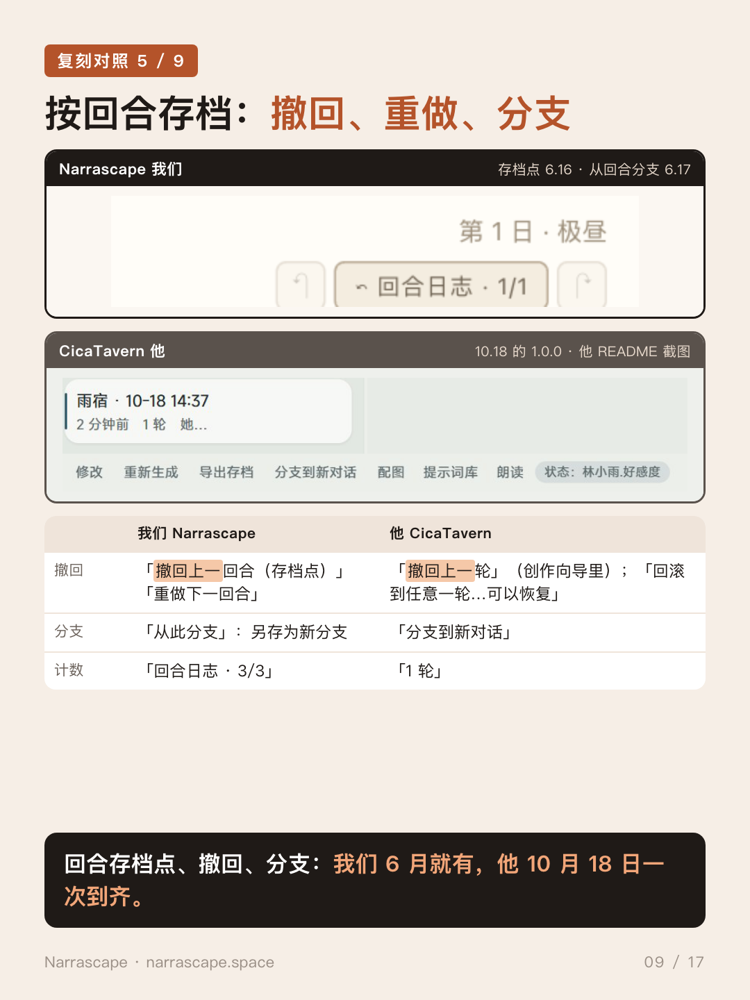

“撤回上一回合”“重做”“从此分支”，我们 6 月 16—17 日就有；他的撤回、回滚、“分支到新对话”都是 10 月 18 日一次到齐。

#### 复刻 6：右栏每轮处理面板

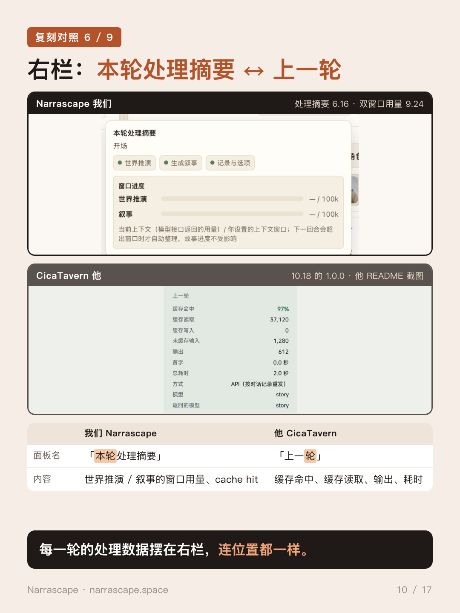

我们的「本轮处理摘要」（6 月 16 日起）在右栏显示每轮的窗口用量和缓存命中；他的「上一轮」在同一个位置显示缓存命中和耗时。

#### 复刻 7：整理上下文 ↔ 压缩上下文

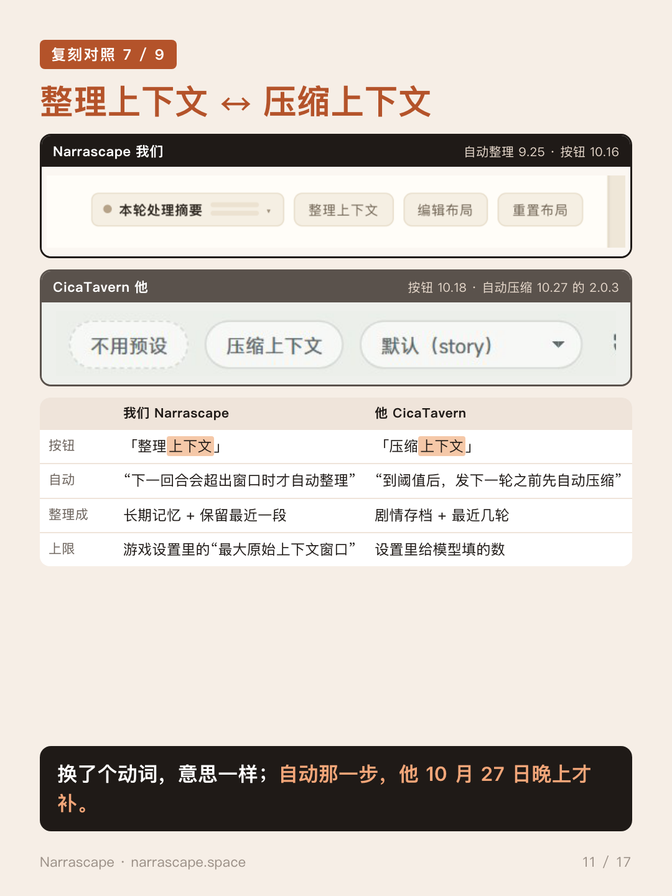

我们“下一回合会超出窗口时才自动整理”（9 月 25 日），按钮 10 月 16 日上线；他的“压缩上下文”按钮 10 月 18 日，自动那一步 10 月 27 日晚上才补。

#### 复刻 8：角色形象、历史版本、换回

我们 10 月 11 日头像和立绘一起生成，10 月 17 日历史形象可以换回；他 10 月 22 日加生成头像，10 月 27 日加“抽图历史”。

#### 复刻 9：几句话建世界，再用对话改

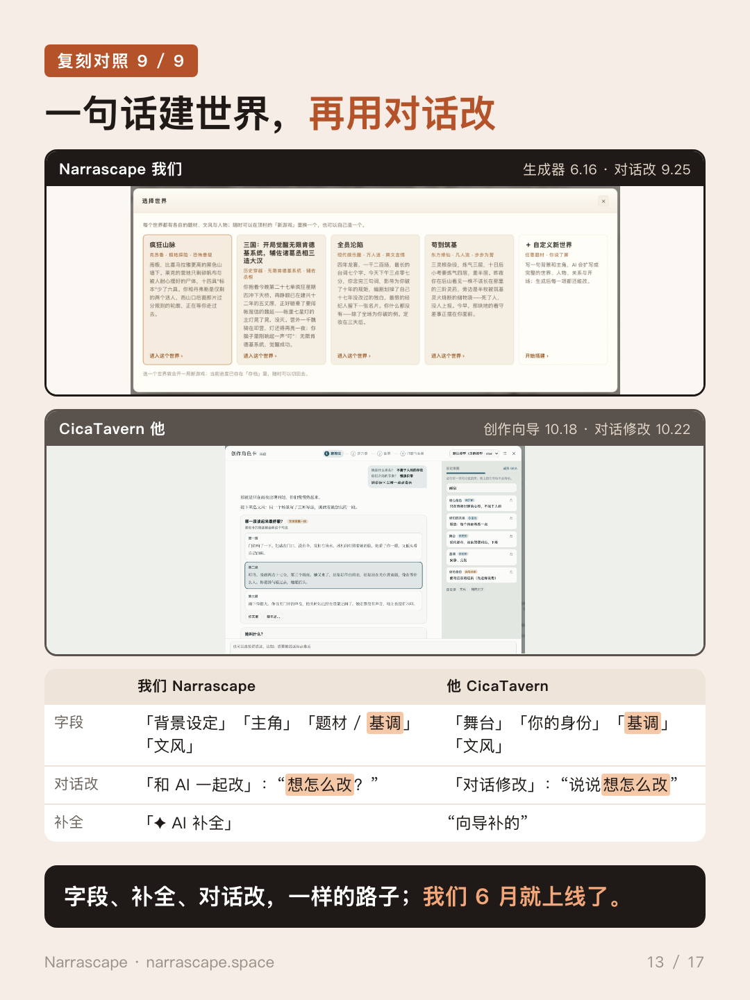

同样的字段（连“基调”都一样）、同样的补全、同样用对话改，连提示语“想怎么改”都一样。我们 6 月 16 日、9 月 25 日；他 10 月 18 日、22 日。

### 四、还当成了招牌

他宣传片片尾列了 8 个卖点，其中 5 个一条条对得上我们先上线的功能：缓存命中高（冻结基线 6 月 16 日）、配图朗读（9 月 6 日 / 10 月 11 日）、定制角色形象（10 月 11 日）、四个行动选项（8 月 25 日）、后台续写（10 月 13 日）。

### 五、连数字都挑

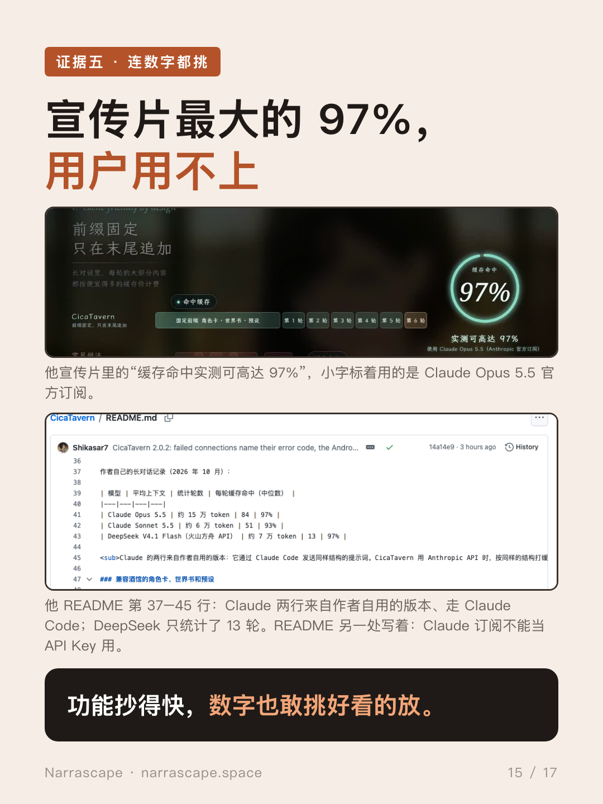

他宣传片里最大的数字是“缓存命中实测可高达 97%”。他自己的 [README（第 37–45 行）](https://github.com/Shikasar7/CicaTavern/blob/14a14e9687ff58c7fd9cc13213858d859013dc0a/README.md?plain=1#L37-L45)写着：Claude 两行来自作者自用的版本、走 Claude Code；另一处又写 Claude 订阅不能当 API Key 用；DeepSeek 那行只统计了 13 轮。

### 六、所以，我们认为

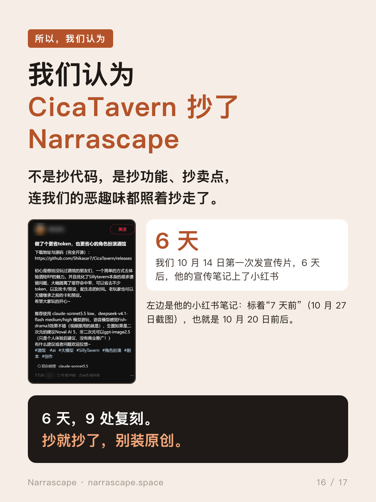

从我们第一次发视频到他的小红书宣传，6 天；复刻 9 处。我们认为 CicaTavern 抄了 Narrascape。

### 七、给个说法

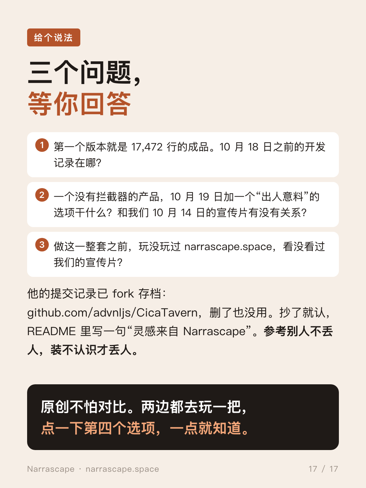

## 为什么第四个选项最说明问题

越界选项在 Narrascape 里不是噱头，而是一个闭环里的一环：

1. 第四个选项是你此刻最想干、平时不敢干的事：亲上去、掀桌子、当众说出秘密。
2. **时空裁判**可能拦下它：这一回合不算，弹窗告诉你为什么。
3. 弹窗最后一句：“可在游戏设置中调整或关闭主角行为限制。”
4. 玩家去设置里从严格调到标准、宽松，甚至**完全不受限**，然后发现这个世界能陪你玩到多疯。

CicaTavern 没有裁判，也没有行为限制设置，他的“出人意料”什么也撞不到，也没有什么可以解锁。单拿某一项，酒馆插件、AI Dungeon 里也许能找到类似的；**但这个闭环，以及围绕它的整套组合和打磨的调性，主流产品里没有。它在我们宣传片发出几天后，出现在了 CicaTavern 里。**

## 五分钟自己核实

1. 打开他的[最早几笔提交](https://github.com/Shikasar7/CicaTavern/commits/main/?since=2026-10-17&until=2026-10-19)：一个只有 LICENSE 的 Initial commit，紧跟 +17,472 行的 [1.0.0](https://github.com/Shikasar7/CicaTavern/commit/cac0f96)。
2. 打开 [`web/media.js` 第 164 行](https://github.com/Shikasar7/CicaTavern/blob/cac0f965d3b68583f2ee73c536702a9d0823a7a9/web/media.js#L164)，找「正在构思画面」。
3. 打开 [`server/basic.mjs` 第 101–108 行](https://github.com/Shikasar7/CicaTavern/blob/48fa11bdfb9af6bda3614921208eb5c01524a705/server/basic.mjs#L101-L108)，10 月 19 日加的：“四项方向各不相同，至少一项出人意料”。
4. 打开 [narrascape.space](https://narrascape.space)，点顶栏 ✦ 看更新日志，玩一回合，点一下第四个选项。
5. 如果原仓库被改了，对照 fork 存档 [advnljs/CicaTavern](https://github.com/advnljs/CicaTavern)。

## 常见问题

**这些功能单独看不是很常见吗？**
单拿一项，有些确实常见，所以我们列的是组合、日期和措辞。七个卖点、九处复刻、一字不差的界面文案，全都出现在我们第一次发视频后的两周内，这不是巧合。

**你们是说他抄代码？**
不是。他的代码是另一套技术栈。我们说的是他复刻了产品：功能、行为、卖点和界面文案。

**凭什么信你们的日期？**
他的日期来自他自己的提交。我们 10 月 11 日起的日期在 app 更新日志里，10 月 14 日的宣传片是公开的；更早的来自我们的开发记录，2023 年的工作在[公开仓库](https://github.com/advnljs/scripted-rpg)里。app 更新日志 10 月 19 日上线，之前几天的条目是上线时补录的。

**你们想要什么？**
一个诚实的回答；如果确实参考了，在 README 里写一句“灵感来自 Narrascape”。

## 给个说法

1. 第一个版本就是 17,472 行的成品。10 月 18 日之前的开发记录在哪？
2. 一个没有裁判的产品，10 月 19 日加一个“出人意料”的第四个选项干什么？和我们 10 月 14 日的宣传片有没有关系？
3. 做这一整套之前，玩没玩过 narrascape.space，看没看过我们的宣传片？

参考别人不丢人，装不认识才丢人。

## 仓库内容

| 目录 | 内容 |
|---|---|
| [`xiaohongshu/`](xiaohongshu/) | 小红书 17 张图和文案（中文） |
| [`evidence-en/`](evidence-en/) | 同一组图的英文版 |
| [`comparison/`](comparison/)、[`comparison/en/`](comparison/en/) | 总览 + 9 张左右对照图，中英文 |
| [`charts/`](charts/) | “每一项都是我们先”对比图，中英文 |
| [`statement/`](statement/) | 完整声明：[中文 PDF](statement/statement-zh.pdf)、[英文](statement/statement-en.md)（[PDF](statement/statement-en.pdf)） |
| [`list/`](list/) | 29 项分级清单：[中文 PDF](list/suspicious-points-zh.pdf)、[英文](list/suspicious-points-en.md) |
| [`screenshots/en/`](screenshots/en/) | 我们线上客户端的英文界面 |
| [`evidence/`](evidence/) | 原始截图：他的 GitHub 页面（10-27 截取）、宣传片截帧和转写、小红书笔记、我们的直播截帧和线上客户端 |

## 关于时间来源

- **CicaTavern 的日期**来自他公开的提交记录和更新日志。GitHub 按 UTC 分组，截图里的“Oct 17”即北京时间 10 月 18 日。
- **Narrascape 的日期**：10 月 11 日起在 app 更新日志里可查（narrascape.space 顶栏 ✦），10 月 14 日宣传片公开；更早的来自开发记录，2023 年的探索在公开仓库 [scripted-rpg](https://github.com/advnljs/scripted-rpg)。
- 引用他仓库和视频的截图，用于评论与对比。

— Narrascape · **[narrascape.space](https://narrascape.space)**

