[← Back to README](../README.md) · [中文 PDF](statement-zh.pdf) · [Suspicious points (EN)](../list/suspicious-points-en.md)

# Copied, then called original

*About CicaTavern · the Narrascape team · October 27, 2026 · [narrascape.space](https://narrascape.space)*

We are Narrascape, a small team making an AI tabletop / interactive-fiction game that runs in the browser. We spent years thinking about the idea. From June 2026 we built it behind closed doors for nearly half a year, with no promotion. **On October 14 we published our first promo video. Six days later (around October 20), the same selling points showed up on Xiaohongshu.**

**Our conclusion: we believe CicaTavern copied Narrascape.** Not the code: the features and the selling points. Even our mischievous streak was copied, without any idea of what it is there for.

**Where the material comes from**

- **Our own development history:** the team's own account.
- **Evidence for the comparison:** public material only.
  - **Ours:** our first promo video, published October 14, and the changelog inside the app (✦ in the top bar of narrascape.space).
  - **His:** his promo note and video on Xiaohongshu, and his public repository: code, commits, README and issues. Screenshots of each are in the appendix.

A point-by-point comparison is in the companion document, [Suspicious points](../list/suspicious-points-en.md).

## 1. Nearly half a year vs. one week

Do the arithmetic:

- From June 15 to October 17, more than four months, we built this whole set one feature at a time.
- Four days after our video, his first version came out. On the fifth day he added the four choices.
- His entire public record covers ten days: 30 versions, over 70,000 lines. On October 18 alone there were 20 commits and 6 versions; the Android app, the exe launcher and in-app updates all came out the same day.

He will probably say it was "already written". But:

- There is no earlier trace of CicaTavern development in any of his public GitHub repositories.
- The first version arrived as one finished 17,472-line commit, with no development history at all.

An "already written" that cannot be shown does not count.

We have forked his commit history as an archive: original at [github.com/Shikasar7/CicaTavern](https://github.com/Shikasar7/CicaTavern), archive at **[github.com/advnljs/CicaTavern](https://github.com/advnljs/CicaTavern)**, frozen at v2.0.2 (commit `14a14e9`, 48 commits). Every commit and version cited here refers to that archive. Deleting things now will not help.

That leaves one explanation: this whole set was "thought of" in the week or so after our video. Coming up in a week with what took us nearly half a year, and so close that it even includes a transgression choice he has no use for, is not plausible.

**Either he is a genius who happened to come up with our entire set in the same month, or he saw the answers. We lean toward the second. If we are wrong, show the development history from before October 18. If it cannot be shown, stop calling it a coincidence.**

## 2. His features have no history

Our features grew bit by bit. His appeared out of nowhere, already finished.

- **Illustrations, character roster, character reference images, art style, read-aloud, background generation:** all of them appeared together in the single v1.0.0 commit on October 18. The image and voice code alone is 2,489 lines, and 551 lines of tests were written along with it. Each feature was complete the first time it appeared; there was no "make a simple version, then improve it" stage.
- **Four action choices:** added on October 19 in v1.6.0 as one toggle of a preset, in a single line. No reason for adding them, and no reason why exactly four or why one must be "surprising".
- **His issue tracker:** 4 entries to date, the earliest on October 20: an import error, a request for search, a provider suggestion and a security patch. Nobody asked for four choices, illustrations or consistent character looks.

No user asked for it, no trial and error, no reason, the whole set at once, and that set is this close to ours.

**A feature with no history has only two possible origins: it fell from the sky, or it was built from someone else's finished product.**

No iteration, no reason, done in one go. That is not development; that is handing in a copied answer sheet.

## 3. Seven selling points, and we shipped every one first

| Feature | Narrascape (public date, changelog wording) | CicaTavern (first appearance) |
|---|---|---|
| Four choices per turn, one of them out of bounds | Finalized Aug 25 (team account); the highlight of our Oct 14 video | v1.6.0, Oct 19 |
| Turn illustrations | Oct 11: "turn illustrations… generated on demand from a button under each turn" | v1.0.0, Oct 18 |
| Fixed character looks, illustrations drawn from them | Oct 11: "avatar and standing portrait generated together, in one style"; Oct 12: "illustrations refer to each character's own portrait… characters stay consistent" | v1.0.0, Oct 18: roster reference images, no mixed-up faces. Standing portraits only on Oct 20, avatar generation only on Oct 22 |
| One art style per world | Oct 12: "each world uses one art style" | v1.0.0, Oct 18: an art style per card |
| One-tap read-aloud | Shipped Sep 6 (team account); a read-aloud button is on screen in our Oct 14 video | v1.0.0, Oct 18 |
| Jobs finish in the background, closing the page doesn't stop them | Oct 13: "image jobs finish in the background; closing the page no longer interrupts them" | v1.0.0, Oct 18: switch away or refresh and the turn still finishes |
| Old versions kept after a redraw, can switch back | Oct 17: "past portraits can be viewed and set as default" | v2.0.0 "draw history", Oct 27 |

How far we led varies: a few days for illustrations and portraits, six weeks for read-aloud, nearly two months for the transgression choice, four months for the frozen baseline. **His all arrive bunched together, 4 to 13 days after our October 14 video.**

Any single item could be called "something everyone has". One collision is a coincidence. **Seven collisions means the GPS was set to our house.**

Even the changelog was only one day behind: ours went into the top bar on October 19, and his v1.8.0 got "What's new" on October 20.

## 4. Every one of our features has a reason

| When | What we built | Why |
|---|---|---|
| Years before | The idea: an AI that runs a living world, where players can cross the line and can be stopped | Team account |
| Jun 15 | Day one: choices every turn; the space-time judge and the "action restriction" setting | Stories need limits. Teleporting, one-shot kills, things beyond your ability get stopped by the judge, and you decide how strict it is |
| Jun 16 | Frozen baseline: the setup is frozen into a fixed baseline at the start, the conversation is append-only, and whatever changes each turn goes last. Plus: a full world from a few lines | The first hits the cache every turn, which is cheaper and faster; the second lets people start without writing pages of setup |
| Jul 14 | Site launched, no promotion | Let a few people play and improve as we go |
| Aug 25 | Transgression choice finalized: three normal choices, the fourth deliberately out of bounds | To bait players into the judge and then point them to settings to loosen it (next section) |
| Sep 6 | Automatic read-aloud | For livestreams: the streamer plays while the story is read aloud for viewers |
| Oct 11–17 | Turn illustrations, character portraits, illustrations drawn from portraits, one art style, background jobs, portrait history | Five rounds of changes in one week, each recorded in the changelog |
| Oct 14 | First public promo video | Six days later, the same selling points were on Xiaohongshu |

Illustrations alone show in the changelog how a feature grows:

- **Oct 11:** turn illustrations ship; the same day they become a button under each turn, generated when wanted.
- **Oct 12:** illustrations follow each character's own portrait so people stay consistent; one art style per world; queueing when the image service is busy; automatic retry when a safety check occasionally refuses.
- **Oct 13:** image jobs move to the background and survive closing the page; finished illustrations can be redrawn.
- **Oct 16:** images cached locally for faster reopening; larger avatars in the character list.
- **Oct 17:** character portraits get multiple versions; old ones can be viewed and restored.

Build it, watch how players use it, fix whatever is awkward. **That is how features grow.**

## 5. The transgression choice: copied without knowing why

Narrascape has an interceptor called the space-time judge. When you make the protagonist do something beyond their ability or against the world's rules, it stops it. The turn doesn't happen, a dialog explains why, and it ends with a hint: "You can adjust or turn off the action restriction in Game Settings." Settings has four levels: strict, standard, loose, and fully unrestricted.

The transgression choice is designed around that interceptor. The first three choices are normal paths; **the fourth is deliberately out of bounds**, the thing you most want to do right now but normally would not dare:

- Sometimes it works, and the story explodes.
- Sometimes the judge stops it, and the dialog tells you: if this is too strict, loosen it in settings.

Its purpose is to lure players into the interceptor. After a few collisions they go to settings, loosen the limit or turn it off entirely, and discover how far this world will go with them. It is the part of our promo video that got the most laughs:

*Narrascape's October 14 video. Left, choice 4: "throw the whole bowl of hot soup at the two beams of light". Right, choice 4: "shout in the street that Zhou Henian will die after the cold wave". The same frame shows the turn illustration and the read-aloud button.*

Now look at his:

- **October 18, v1.0.0:** no choice feature of its own; it only shows choices that come with a character card as buttons.
- **October 19, the fifth day after our video:** suddenly built-in "four action choices", with a prompt that says "the four go in different directions, at least one is surprising".

Exactly four, one of them deliberately breaking expectations. That is our transgression choice under a different name.

**The problem: CicaTavern has no interceptor at all.**

No judge, no action restriction, no "loosen it in settings" step; whatever the model writes, goes. A "surprising" choice there has nothing to run into and nothing to unlock. It is decoration.

*CicaTavern's promo video (around 00:38). Buttons A to D look identical, and the "surprising" fourth one is a joke.*

That is copying the outline without understanding it. Our mischievous streak has a purpose; it grew out of the interceptor. He copied what it looks like without knowing where the mechanism comes from. Without the interceptor, the fourth choice is just an outrageous button.

## 6. Caching: a design we already ran, and a number users can't get

The "fixed prefix, append only at the end" that his video sells as its top technical feature is what we had been doing since June 16. Internally we call it the **frozen baseline**: freeze a baseline at the start, append only after that, and put whatever changes each turn at the end.

His approach has the same three parts: fixed prefix, append-only, changing material last. Ours was running in production from our July launch, three months earlier. In his hands it became the loudest selling point of his video.

### Tonight he followed one more: a context meter and auto-compaction

At 21:42 on October 27 he released v2.0.3: the top bar shows how much context the conversation uses and the limit, compacts automatically before the next turn once a threshold is reached, and lets you set the limit in settings.

In our app, the "Context usage" item in the turn-process panel reads: the context actually sent to the model this turn / the context window limit; only when it would exceed the limit is it consolidated into long-term memory, keeping the most recent stretch; the limit can be adjusted in Game Settings.

| | Narrascape (wording in the app) | CicaTavern v2.0.3 |
|---|---|---|
| What it shows | "current context / the context window you set" | used / limit, changes color at the threshold |
| Where usage comes from | "usage returned by the model API": input + output of the last request | tokens actually counted in the last turn |
| When it compacts | "automatically, only when the next turn would exceed the window" | after the threshold, before sending the next turn |
| Who sets the limit | "max raw context window" in Game Settings | a number entered for the model in settings |
| What it becomes | long-term memory, keeping the most recent stretch | a story archive, continuing from the last few turns |

Our context consolidation already had a round of fixes in the October 18 changelog. He added his late on October 27. A few words changed, same meaning. Even people copying homework know to reword it.

*v2.0.3 came out after our fork archive, as commit `d7974cb` in the original repository; we archived its release notes separately.*

Then the number. The most prominent claim in his video is "measured cache hit rate up to 97%", with small print saying it used an official Claude Opus 5.5 subscription.

His README says:

- The two Claude rows come from **the author's personal setup**, running through Claude Code.
- Elsewhere the same README says a Claude subscription **cannot be used as an API key**.
- The DeepSeek row also shows 97%, over 13 turns.

In plain terms: the biggest number in his video was measured in a setup CicaTavern users cannot use. Quick to copy features, and willing to pick the flattering numbers too.

## 7. Don't rush to post a code comparison

We never said he copied code. We read it: a different tech stack, and diligently written.

But anyone can rewrite something in another stack these days. What is valuable was never the code; it is the idea: what to build, why, and in what order. All of that was in our video and our app in mid-October, in plain view of anyone, including him.

He took the surface. What he could not take is the reason behind each feature:

- the transgression choice exists to make players hit the interceptor and then loosen it in settings;
- read-aloud exists because livestreams need it;
- illustrations took five rounds of changes in one week to get right.

He only copied the buttons.

Put plainly, this is copied homework: the answers copied fast, the questions not understood. The transgression choice was the answer to a question posed by the interceptor. He took the answer; the question stayed with us.

## 8. We want an explanation

1. The first version was a finished 17,472-line commit. Where is the development history from before October 18? Can it be shown?
2. v1.0.0 had no built-in four choices; they arrived on October 19, with one reserved for "surprising". What does a product with no interceptor need that choice for? Does it have anything to do with our October 14 video?
3. Before building all of this, had you played narrascape.space or watched our video?

If it was copied, admit it: one line in the README saying "inspired by Narrascape", and this is over. There is no shame in learning from others; the shame is in pretending not to know them.

Every indie developer knows how many late nights it takes for a feature to go from idea to working to polished to on video. A few days later it shows up under another name as a selling point in someone else's video, pitched to the same players as "less hassle". We are not letting that go.

**Originals are not afraid of comparison. Play both, tap the fourth choice, and see whether it gets stopped and what happens after. Which one is the original and which one is a tracing becomes obvious with one tap.**

— Narrascape · [narrascape.space](https://narrascape.space)

---

## Appendix: screenshots

All screenshots below are from his public GitHub pages and videos, taken October 27, 2026. GitHub groups commits by UTC: "Oct 17" at 17:30 UTC is 01:30 on October 18 in UTC+8.

The nine side-by-side comparison cards (features and UI copy) are in [`../comparison/`](../comparison/).

**0. His Xiaohongshu promo note, around October 20**

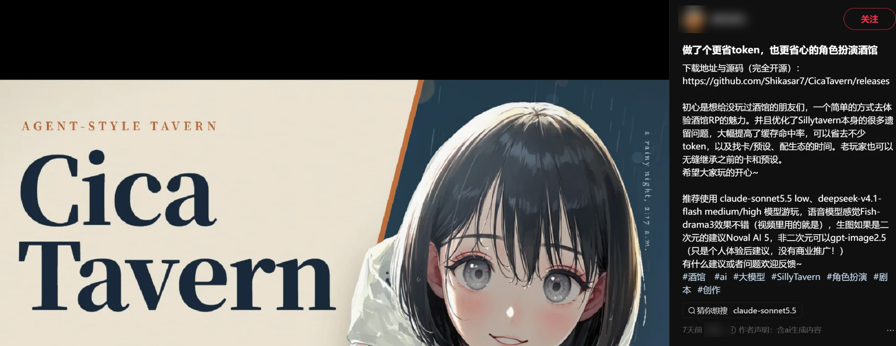

*Marked "7 days ago" when captured on October 27.*

**1. The first commits: Initial commit, then straight to v1.0.0**

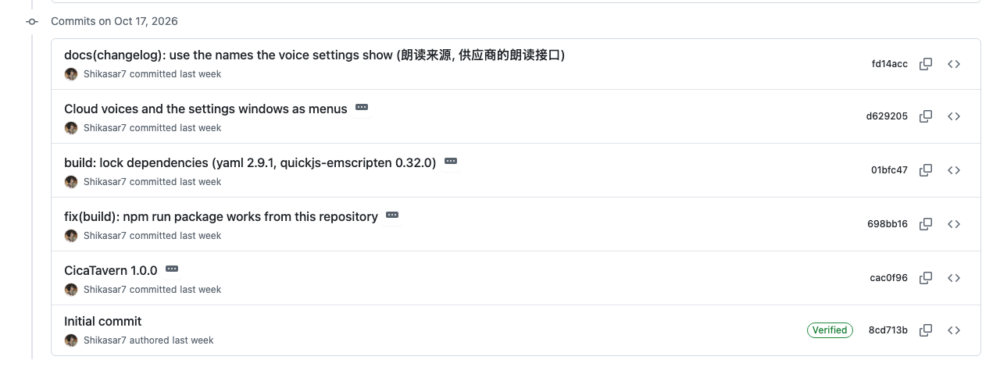

*At the bottom is the Initial commit (only a LICENSE and a one-line README), followed immediately by CicaTavern 1.0.0 and several more versions the same day.*

**2. v1.0.0: 72 files, 17,472 lines, one commit**

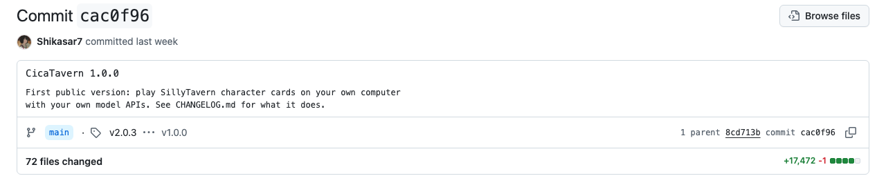

*Illustrations, character roster, art style, read-aloud, background generation, all in this one commit.*

**3. v1.6.0 on October 19: four choices, "at least one is surprising"**

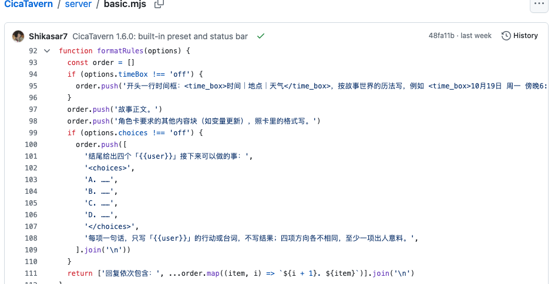

*`server/basic.mjs` lines 101–108. The fifth day after our video.*

**4. v2.0.0 and v2.0.3 on October 27: draw history, context meter**

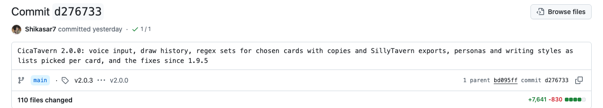

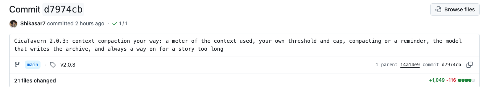

*We shipped "past portraits can be viewed and restored" on October 17; our app had context usage and automatic consolidation long before.*

**5. The 97% in his README: the author's personal setup via Claude Code**

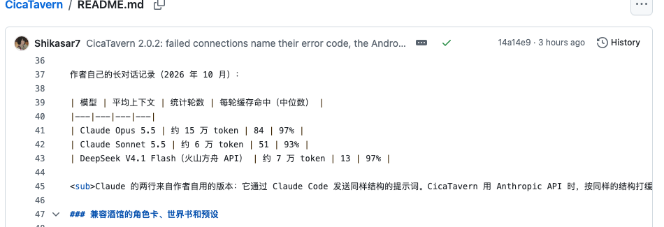

*README lines 37–45, the source of the biggest number in his video.*

**6. The selling points his video emphasizes**

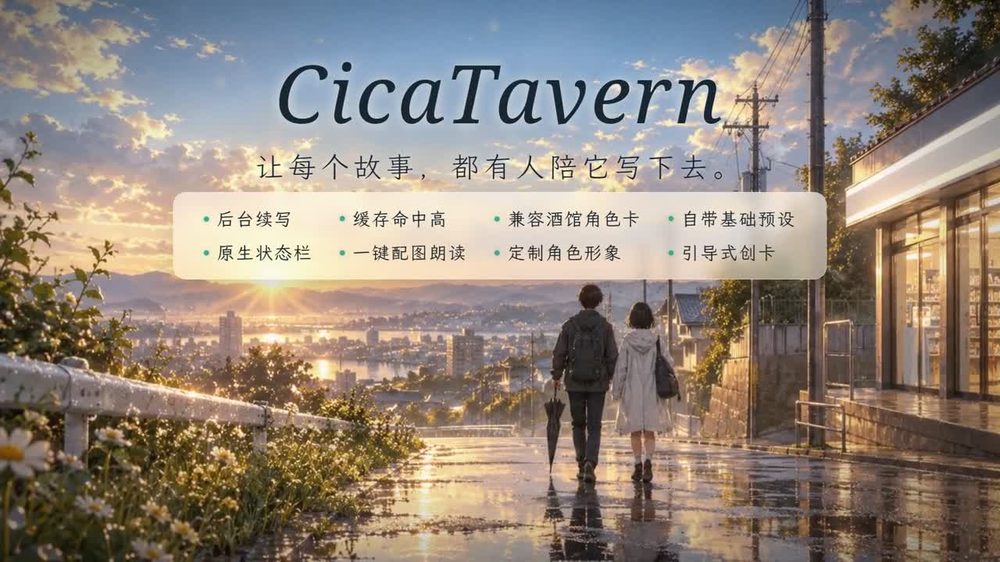

*End card: background generation, high cache hit rate, SillyTavern card compatibility, built-in basic preset, native status bar, one-tap illustration and read-aloud, custom character looks, guided card creation.*

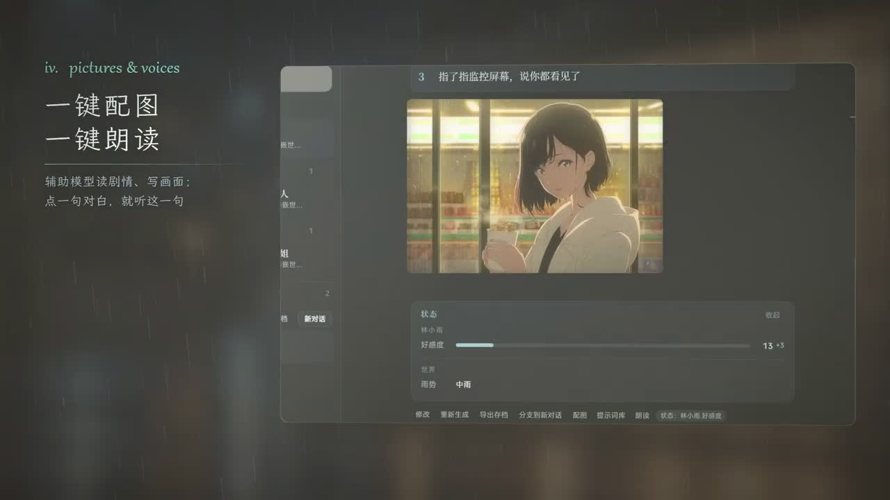

*"One-tap illustration, one-tap read-aloud"*

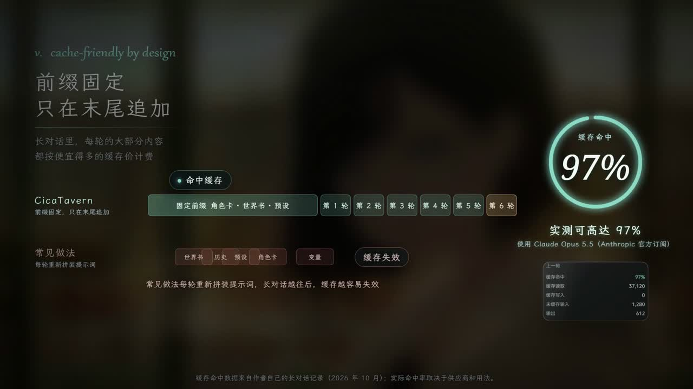

*"Fixed prefix, append only at the end", cache hit rate 97%*

**7. Issues: 3 in total, nobody asked for these features**

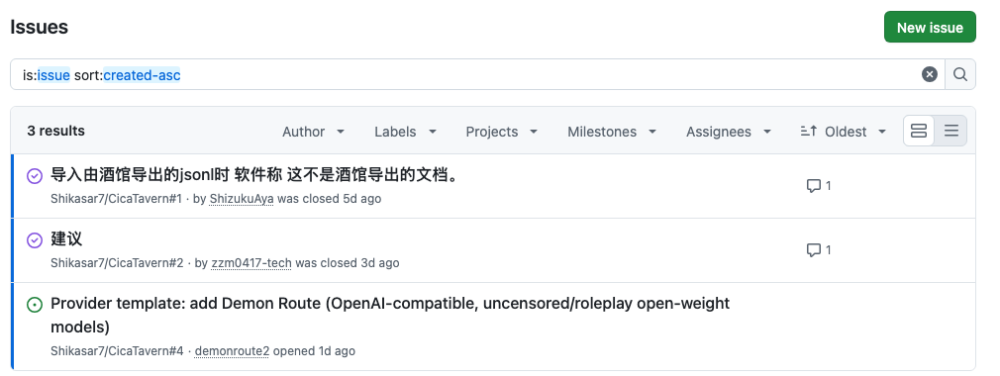

*Plus one security-patch pull request, 4 entries in all.*
